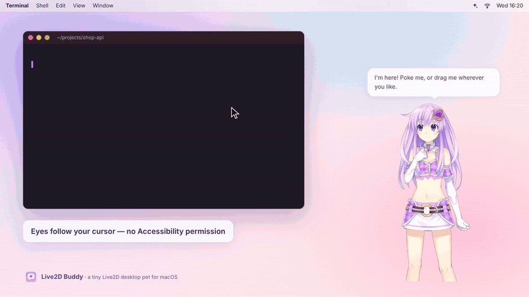
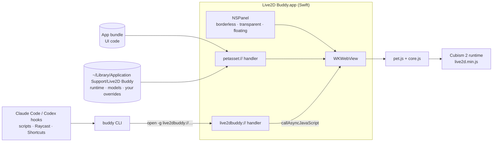

<div align="center">


# Live2D Buddy

**A tiny, native Live2D desktop pet for macOS — and a one-line way for your AI agents to talk through her.**

English · [简体中文](README.zh-CN.md)


[](LICENSE)



<sub>Recorded from the real renderer · <a href="docs/media/demo-en.mp4">MP4</a> · demo characters © their owners, not included</sub>

</div>

## Why

- **Tiny and native.** One Swift file (AppKit + `WKWebView`), a < 1 MB universal app, no Electron, no runtime dependencies, no background network traffic. It renders at 30 fps and throttles its cursor polling when you are idle — about half the CPU of the prototype it grew out of.
- **Feels alive.** Eyes and head follow your cursor anywhere on screen *without* Accessibility permission. Hover and click reactions with separate head / upper-body zones, idle motions, blinking, gentle companion lines every few minutes. Drag her anywhere; clicks fall through transparent pixels to the app behind.
- **Agent-aware, not an agent.** A `buddy` CLI and a `live2dbuddy://` URL scheme let Claude Code, Codex or any script make her celebrate when a task finishes and wave when approval is needed — via hooks, zero tokens, privacy-preserving by default.
- **Licence-clean.** No third-party art or runtime in this repository or its releases. The Live2D runtime and demo characters are fetched on demand, pinned to exact upstream revisions and verified by SHA-256.

## Quick start

**One line** (installs to `~/Applications`, adds the `buddy` CLI, asks before downloading the demo characters):

```sh
curl -fsSL https://raw.githubusercontent.com/Liloker/live2d-buddy/main/install.sh | zsh
```

**From source** (Xcode or Command Line Tools):

```sh
git clone https://github.com/Liloker/live2d-buddy.git && cd live2d-buddy
make run        # build → fetch runtime + demo characters (asks first) → launch
make install    # → ~/Applications/Live2D Buddy.app and ~/.local/bin/buddy
```

**Release zip:** download from [Releases](https://github.com/Liloker/live2d-buddy/releases), open the app, then right-click the pet → **Get demo characters…**. The build is ad-hoc signed, not notarized — if macOS refuses to open it, use **System Settings → Privacy & Security → Open Anyway** (the curl installer avoids this).

## Using it

| You do | She does |
| --- | --- |
| Move the mouse anywhere | Eyes, head and body follow with smoothing |
| Hover over her | A playful line (with a cooldown, no flicker) |
| Click head / upper body | Different motions + a click line |
| Drag | Moves; position is remembered |
| Right-click, or the ✨ menu-bar icon | Switch character, bigger / smaller, random bubbles on/off, say something, get demo characters, open assets folder, hide, quit |

Menus and lines follow your macOS language (Chinese or English). Lines are plain JSON you can override — see [docs/custom-models.md](docs/custom-models.md#lines).

## Let your agents drive her

```sh
buddy say "Deploy finished 🚀"
buddy event done        # done | attention | error | thinking → motion + line
buddy character tia
```

**Claude Code** — add to `~/.claude/settings.json`:

```json
{
  "hooks": {
    "Stop": [{ "hooks": [{ "type": "command", "command": "$HOME/.local/bin/buddy hook claude", "async": true }] }],
    "Notification": [{ "matcher": "permission_prompt|idle_prompt",
      "hooks": [{ "type": "command", "command": "$HOME/.local/bin/buddy hook claude", "async": true }] }]
  }
}
```

**Codex** — in `~/.codex/config.toml`: `notify = ["/Users/YOU/.local/bin/buddy", "hook", "codex"]`

Bubbles show generic lines by default — never your prompt, code or the agent's reply (`--preview` opts in). Full reference, URL scheme and design notes: **[docs/agents.md](docs/agents.md)**.

## Characters

| | Character | Source | Rights |
| --- | --- | --- | --- |
| default | Nepgear (紫色露腰款) | [fghrsh/live2d_api](https://github.com/fghrsh/live2d_api) | Hyperdimension Neptunia © IDEA FACTORY / COMPILE HEART |
| | Tia (小恶魔) | [fghrsh/live2d_api](https://github.com/fghrsh/live2d_api) | © Potion Maker |

They are **not** part of this project: upstream allows study and personal use only, no commercial use. `make assets` / the menu downloads them into `~/Library/Application Support/Live2D Buddy/` after showing that notice.

**Bring your own** Cubism 2 model: drop it in that folder and add an entry to `characters.json` — [docs/custom-models.md](docs/custom-models.md).

## How it works



- **Gaze without permissions:** the shell polls `NSEvent.mouseLocation` (30 Hz, ~3 Hz while the cursor rests) and passes window-relative coordinates to the page.
- **Pixel-accurate click-through:** the page reads the WebGL alpha under the cursor; the panel ignores mouse events unless you are over her.
- **Stable framing:** after the first frame the renderer measures the visible artwork and keeps that framing while she animates; the window keeps a per-character aspect ratio.
- **Safe bridge:** native → page calls pass values with `callAsyncJavaScript(arguments:)`, never by splicing strings into code.

```
app/        main.swift (app + CLI), Info.plist, icon
web/        index.html, pet.js (renderer), core.js (pure logic), characters.json, lines/
scripts/    build.sh, fetch-assets.sh        assets/manifest.tsv   (pinned URLs + SHA-256)
bin/buddy   CLI wrapper                       install.sh            (one-line installer)
tests/      core.test.cjs (make test)         docs/                 agents, custom models, demo
```

`make smoke` launches the real app and verifies every character renders, hit zones, bubble toggling and the URL-command path.

## Roadmap

- [x] Native shell, Cubism 2 renderer, two demo characters, bilingual UI
- [x] Portable build, checksum-pinned asset fetcher, universal release, CI
- [x] `buddy` CLI + URL scheme + Claude Code / Codex hook recipes
- [ ] **`buddy-mcp`** — a ~60-line stdio MCP server (`pet_say`, `pet_react`, `pet_event`, `pet_set_character`) on top of the CLI, for agents that want to *express* things rather than just report status ([why hooks come first](docs/agents.md#why-hooks--cli-before-mcp))
- [ ] Long-task state machine (thinking → working → waiting → done) with per-character motion mapping
- [ ] Interop instead of a new standard: accept OpenPets-style MCP calls and Codex pet states
- [ ] Cubism 3/4/5 (`.moc3`) via the official Cubism Core, downloaded by the user
- [ ] Drop a model folder onto the pet to add it; costume switching (Tia has 60+ outfits upstream)
- [ ] Multi-monitor edge peeking, launch at login
- [ ] Developer ID signing + notarization, Homebrew cask

## Similar projects

Agent-aware desktop pets became a crowded space in 2026 — if you want a cross-platform, batteries-included tool, these are great (stars as of Oct 2026):

| Project | Stack | Focus |
| --- | --- | --- |
| [clawd-on-desk](https://github.com/rullerzhou-afk/clawd-on-desk) · 6.5k★ | Electron | Pixel pet for 20+ coding agents, permission bubbles, dashboards |
| [OpenPets](https://github.com/OpenPetsHQ/openpets) · 1.3k★ | Electron | Companion platform with plugin SDK and MCP |
| [alterhq/openpets](https://github.com/alterhq/openpets) | Swift | Shared macOS pet with MCP/CLI, Codex pets |
| [Hopet](https://github.com/BinaryFroggy/Hopet) | Swift | Claude Code / Codex session state, notch status |
| [BongoCat](https://github.com/ayangweb/BongoCat) · 24k★ | Tauri | Live2D cat that mirrors your keyboard/mouse |
| [live2d-widget](https://github.com/stevenjoezhang/live2d-widget) · 11k★ | Web | The blog widget this pet grew out of |

Live2D Buddy's niche: a *Live2D-quality* character in a sub-megabyte native app, with the smallest possible control surface for agents.

## License & credits

Code and icon: [MIT](LICENSE). The Live2D Cubism 2 runtime (© Live2D Inc.) and the demo characters are third-party and not included — see [THIRD_PARTY_NOTICES.md](THIRD_PARTY_NOTICES.md). Thanks to [fghrsh/live2d_api](https://github.com/fghrsh/live2d_api) and [stevenjoezhang/live2d-widget](https://github.com/stevenjoezhang/live2d-widget), which brought these characters to countless blogs.
