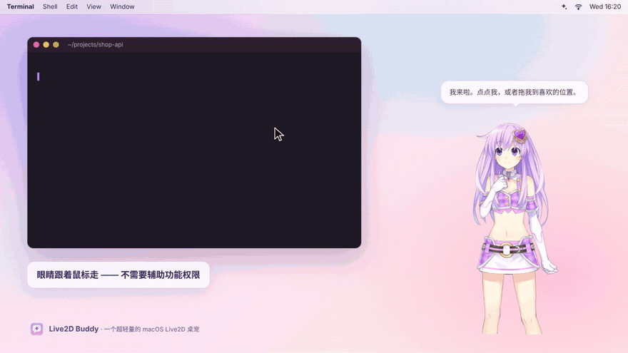
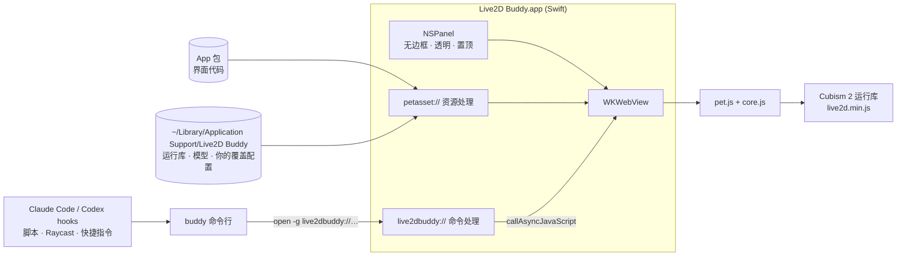

<div align="center">


# Live2D Buddy · Live2D 小伙伴

**一个超轻量的 macOS 原生 Live2D 桌宠 —— 也是你的 AI Agent 跟你“说话”的最短路径。**

[English](README.md) · 简体中文


[](LICENSE)



<sub>由真实渲染器录制 · <a href="docs/media/demo-zh.mp4">MP4</a> · 示例角色版权归原作者，不随仓库分发</sub>

</div>

## 为什么做它

- **小而原生**：一个 Swift 文件（AppKit + `WKWebView`），通用二进制 App 不到 1 MB；没有 Electron、没有运行时依赖、后台不联网。30 fps 渲染、鼠标静止时自动降低轮询频率 —— CPU 占用约为最初原型的一半。
- **像活的一样**：眼睛和头会跟着屏幕上任意位置的鼠标转，**不需要辅助功能权限**；悬停、点击头部/上身有不同反应；待机动作、眨眼、每隔几分钟一句陪伴台词；可以随意拖动，透明区域的点击会穿透到后面的窗口。
- **能被 Agent 驱动，但它自己不是 Agent**：`buddy` 命令行 + `live2dbuddy://` URL scheme，Claude Code、Codex 或任何脚本都能让她在任务完成时庆祝、需要你批准时招手 —— 走 hooks，不消耗 token，默认不泄露隐私。
- **许可干净**：仓库和 Release 里没有任何第三方美术资源或运行库。Live2D 运行库和示例角色在你本机按需下载，锁定到上游的确切版本并逐个校验 SHA-256。

## 快速开始

**一行安装**（优先安装最新 Release，没有 Release 时自动从源码编译；装到 `~/Applications`，附带 `buddy` 命令，下载示例角色前会先征求同意）：

```sh
curl -fsSL https://raw.githubusercontent.com/Liloker/live2d-buddy/main/install.sh | zsh
```

**从源码构建**（需要 Xcode 或 Command Line Tools）：

```sh
git clone https://github.com/Liloker/live2d-buddy.git && cd live2d-buddy
make run        # 编译 → 下载运行库和示例角色（会先询问）→ 启动
make install    # 安装到 ~/Applications/Live2D Buddy.app 和 ~/.local/bin/buddy
```

**下载 Release 压缩包**：发布 Release 后可在 [Releases](https://github.com/Liloker/live2d-buddy/releases) 下载，打开 App，右键桌宠 →「下载示例角色…」。App 只做了 ad-hoc 签名、未经 Apple 公证；如果系统拒绝打开，去「系统设置 → 隐私与安全性 → 仍要打开」（用上面的 curl 安装不会遇到这个问题）。

> 国内网络：资源下载按 jsDelivr → fastly → GitHub → gcore 依次尝试，并会自动沿用 macOS 系统代理；也可以用 `scripts/fetch-assets.sh --from <本地目录>` 离线导入。

## 怎么玩

| 你做 | 她的反应 |
| --- | --- |
| 在屏幕任意位置移动鼠标 | 眼睛、头、身体依次平滑跟随 |
| 鼠标移到她身上 | 冒一句俏皮话（有冷却，不会闪烁） |
| 点击头部 / 上身 | 不同的动作 + 一句点击台词 |
| 按住拖动 | 移动位置，松手后记住 |
| 右键她，或点菜单栏 ✨ 图标 | 切换角色、放大/缩小、随机气泡开关、说句话、下载示例角色、打开资源文件夹、隐藏、退出 |

菜单和台词跟随 macOS 首选语言（中文 / 英文）。台词是普通 JSON，可以自己改 —— 见 [docs/custom-models.md](docs/custom-models.md#lines)。

## 让 Agent 来控制她

```sh
buddy say "部署完成 🚀"
buddy event done        # done | attention | error | thinking → 动作 + 台词
buddy character tia
```

**Claude Code** —— 加到 `~/.claude/settings.json`：

```json
{
  "hooks": {
    "Stop": [{ "hooks": [{ "type": "command", "command": "$HOME/.local/bin/buddy hook claude", "async": true }] }],
    "Notification": [{ "matcher": "permission_prompt|idle_prompt",
      "hooks": [{ "type": "command", "command": "$HOME/.local/bin/buddy hook claude", "async": true }] }]
  }
}
```

**Codex** —— 在 `~/.codex/config.toml` 里：`notify = ["/Users/你的用户名/.local/bin/buddy", "hook", "codex"]`

默认只显示通用台词，绝不把你的 prompt、代码或 Agent 的回复显示在气泡里（录屏、共享屏幕也安心）；需要预览可加 `--preview`。完整参考、URL scheme 和设计取舍见 **[docs/agents.md](docs/agents.md)**。

## 角色

| | 角色 | 来源 | 版权 |
| --- | --- | --- | --- |
| 默认 | 紫色露腰款（Nepgear） | [fghrsh/live2d_api](https://github.com/fghrsh/live2d_api) | 《超次元游戏 海王星》© IDEA FACTORY / COMPILE HEART |
| | 小恶魔 Tia | [fghrsh/live2d_api](https://github.com/fghrsh/live2d_api) | © Potion Maker |

它们**不属于**本项目：上游声明“模型版权均属于原作者，仅供研究学习，不得用于商业用途”。`make assets` 或菜单里的「下载示例角色…」会在提示后把它们下载到 `~/Library/Application Support/Live2D Buddy/`。

**换成你自己的 Cubism 2 模型**：放进同一个文件夹，在 `characters.json` 里加一条 —— 见 [docs/custom-models.md](docs/custom-models.md)。

## 工作原理



- **不要权限的视线跟随**：原生层轮询 `NSEvent.mouseLocation`（30 Hz，鼠标静止时约 3 Hz），把相对窗口的坐标交给页面。
- **像素级点击穿透**：页面读取鼠标下方的 WebGL alpha，只有指到她身上时窗口才接收鼠标事件。
- **稳定取景**：第一帧后测量可见画面范围并固定构图；窗口按角色保持各自的宽高比。
- **安全的桥接**：原生调用页面一律用 `callAsyncJavaScript(arguments:)` 传值，不拼接代码字符串。

```
app/        main.swift（App + CLI）、Info.plist、图标
web/        index.html、pet.js（渲染）、core.js（纯逻辑）、characters.json、lines/
scripts/    build.sh、fetch-assets.sh          assets/manifest.tsv（锁定的 URL + SHA-256）
bin/buddy   命令行包装                          install.sh（一行安装脚本）
tests/      core.test.cjs（make test）          docs/（Agent 接入、自定义模型、演示录制）
```

`make smoke` 会真正启动 App，逐个验证所有角色能渲染、点击分区、气泡开关和 URL 命令通路。

## 路线图 / TODO

- [x] 原生外壳、Cubism 2 渲染、两个示例角色、中英双语界面
- [x] 可移植构建、带校验的资源下载器、通用二进制 Release、CI
- [x] `buddy` 命令行 + URL scheme + Claude Code / Codex hooks 配方
- [ ] **`buddy-mcp`**：约 60 行的 stdio MCP 服务（`pet_say`、`pet_react`、`pet_event`、`pet_set_character`），基于 CLI 实现，给想让模型*主动表达*（而不只是汇报状态）的场景用（[为什么先做 hooks](docs/agents.md#why-hooks--cli-before-mcp)）
- [ ] 长任务状态机（思考 → 执行 → 等待 → 完成），每个角色可配置对应动作
- [ ] 兼容现有协议而不是再造标准：接受 OpenPets 风格的 MCP 调用、Codex pet 状态
- [ ] 支持 Cubism 3/4/5（`.moc3`），由用户自行下载官方 Cubism Core
- [ ] 把模型文件夹拖到桌宠身上即可添加；换装（上游的 Tia 有 60 多套衣服）
- [ ] 多显示器贴边探头、开机自启
- [ ] Developer ID 签名 + 公证、Homebrew cask

## 同类项目

2026 年“能感知 AI Agent 的桌宠”已经很拥挤了 —— 如果你想要跨平台、功能齐全的方案，下面这些都很好（star 数截至 2026-10）：

| 项目 | 技术栈 | 侧重 |
| --- | --- | --- |
| [clawd-on-desk](https://github.com/rullerzhou-afk/clawd-on-desk) · 6.5k★ | Electron | 像素桌宠，支持 20+ 编程 Agent、权限气泡、看板 |
| [OpenPets](https://github.com/OpenPetsHQ/openpets) · 1.3k★ | Electron | 带插件 SDK 和 MCP 的陪伴平台 |
| [alterhq/openpets](https://github.com/alterhq/openpets) | Swift | macOS 共享桌宠，MCP/CLI，支持 Codex pets |
| [Hopet](https://github.com/BinaryFroggy/Hopet) | Swift | Claude Code / Codex 会话状态 + 刘海状态条 |
| [BongoCat](https://github.com/ayangweb/BongoCat) · 24k★ | Tauri | 跟着键盘鼠标敲击的 Live2D 猫 |
| [live2d-widget](https://github.com/stevenjoezhang/live2d-widget) · 11k★ | Web | 这只桌宠最初来自的博客看板娘组件 |

Live2D 小伙伴的定位：在不到 1 MB 的原生 App 里放一个 *Live2D 品质* 的角色，并给 Agent 留一个尽可能小的控制面。

## 许可与致谢

代码和图标采用 [MIT](LICENSE)。Live2D Cubism 2 运行库（© Live2D Inc.）和示例角色属于第三方，不随本项目分发 —— 详见 [THIRD_PARTY_NOTICES.md](THIRD_PARTY_NOTICES.md)。感谢 [fghrsh/live2d_api](https://github.com/fghrsh/live2d_api) 和 [stevenjoezhang/live2d-widget](https://github.com/stevenjoezhang/live2d-widget) 把这些角色带到了无数博客里。
